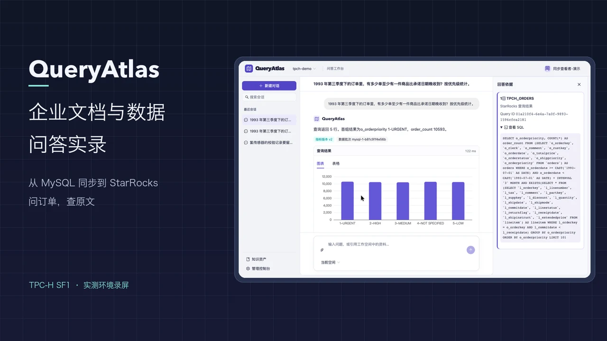
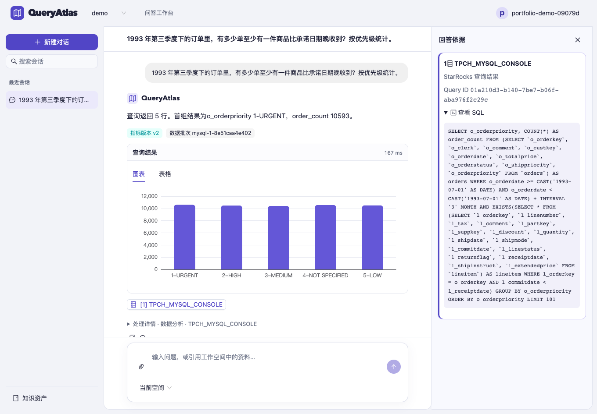
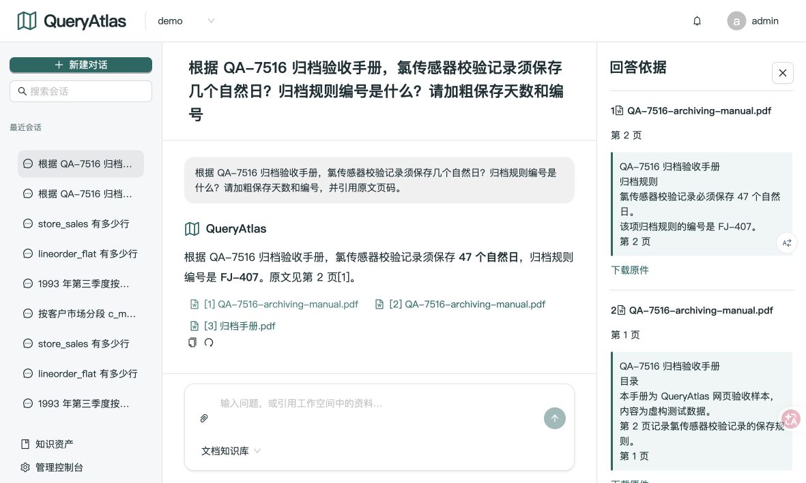
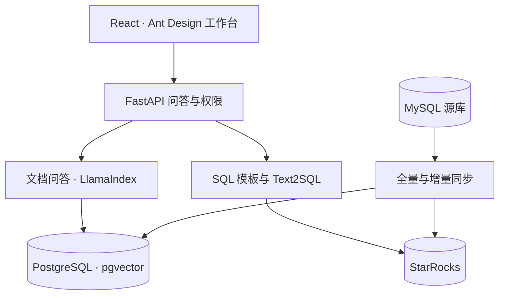

<p align="center"></p>
<h1 align="center">QueryAtlas</h1>
<p align="center"><strong>企业文档与数据问答工作台</strong></p>
<p align="center">问文档能核对原文页码，问数据能查看 StarRocks 实际执行的 SQL 和 Query ID。</p>
<p align="center">
  <a href="https://blog.mlxb.cc/projects/queryatlas-demo/">观看演示视频</a> ·
  <a href="#界面实录">界面实录</a> ·
  <a href="#数据基线">数据基线</a> ·
  <a href="#快速启动">快速启动</a> ·
  <a href="./architecture.md">架构方案</a>
</p>

## 演示视频

[](https://blog.mlxb.cc/projects/queryatlas-demo/)

[观看 1 分 32 秒的演示](https://blog.mlxb.cc/projects/queryatlas-demo/) · [本片实测记录](deploy/etl/results/tpch-sf1-demo-video-2026-11-25.json)

用 TPC-H SF1 的订单、明细和官方刷新集，实录 MySQL 全量与增量同步、工作空间权限、订单问答及 PDF 第 2 页原文。同步等待已剪辑，画面保留实际耗时。

## 界面实录



> 1993 年第三季度下的订单里，有多少单至少有一件商品比承诺日期晚收到？按优先级统计。

截图为同一 TPC-H SF1 刷新批次的网页复测。查询结果可以切换成表格，右侧可核对实际 SQL 和 Query ID。

查文档时也可以直接问「这份验收手册要求把记录保存多久？能标出原文页码吗？」

<details>
<summary>查看 MySQL 同步、批次和失败原因</summary>

控制台可以查看全量、增量、无变更和失败原因。 [网页实测记录](deploy/etl/results/tpch-sf1-console-2026-11-25.json)

</details>

<details>
<summary>查看 PDF 问答与第 2 页原文引用</summary>



*文档链路使用演示 PDF 验收，右栏显示所引用的页码和段落。*

</details>

## 数据基线

| 验证项 | 实测结果 |
| --- | --- |
| TPC-H SF1 正确性 | **8 张源表行数一致，22 / 22 题通过上游参考答案校验** |
| MySQL → StarRocks 批量同步 | **7,501,215 行全量对账一致**。控制台实测全量 **324.578 秒**，官方刷新集增量 **20.63 秒**。 [网页实测记录](deploy/etl/results/tpch-sf1-console-2026-11-25.json) |
| SSB 与 TPC-DS SF1 | 分别完成 **13** 与 **99** 题的执行与耗时记录 |
| StarRocks 物化视图 | TPC-H 月度折扣汇总结果一致，P95 从 **87.54 ms** 降至 **16.76 ms** |

正确性校验记录了 DBGEN 源文件哈希、数据批次和参考答案版本。TPC-H Q4 用固定验证日期 `1993-07-01`，五行结果逐值核对。物化视图耗时来自单节点配对实验，统计的是 SQL 查询时间。 [TPC-H 校验报告](deploy/bench/results/tpch-sf1-qualification.json) · [三套基准执行记录](deploy/bench/results/sf1-queries.json) · [调优实验](deploy/bench/results/tuning-sf1.md)

## 如何工作

- **文档问答**　导入 PDF、Word、图片、HTML 或表格。扫描页和图片先做 OCR，按页或段落切分，再经 LlamaIndex 流水线向量化。pgvector 在当前用户权限下召回片段，回答附原文页码或段落。
- **数据问答**　常用指标执行工作空间中已配置的 SQL 模板。自由提问由 DeepSeek Flash 或本地模型生成 SQL，经语法树校验后由 StarRocks 只读执行。已配置溯源的模板可展示版本、批次和绑定的原文。
- **数据库同步**　从「数据导入 → MySQL 同步」配置数据源，手动运行全量或增量同步，查看每批结果和失败原因。工作空间可分别授予查看、配置和运行权限。 [同步配置与复现步骤](deploy/etl/README.md)
- **控制台**　支持文件导入、CSV 字段映射和校验、模板试跑与启停、工作空间权限、审计和监控告警。



## 快速启动

准备 Linux x86-64、Docker Compose、Python 3.10+ 和 Node.js 22.12+。在仓库根目录运行，首次启动会下载本地模型。

```sh
./deploy/prepare.sh
python3 deploy/model.py
(cd frontend && npm ci && npm run build)
docker compose --profile local-llm up -d --build
curl --fail --retry 12 --retry-all-errors --retry-delay 2 http://127.0.0.1:18650/readyz
```

打开 [本地工作台](http://127.0.0.1:18650)，用部署目录中生成的 `bootstrap.key` 登录。先导入一份 PDF 试问，再按部署指南装载基准数据。 [完整部署指南](部署指南.md)

## 项目文档

- [需求方案](requirements.md) · [架构设计](architecture.md) · [评测方法](evaluation.md)
- [权限与实机验收](权限与验收.md) · [部署、模型配置和运维](部署指南.md)

当前文档检索使用向量召回，增量同步读取源库的变更表。关键词与向量融合、业务库实时同步和自由 Text2SQL 的完整盲测属于后续工作。
