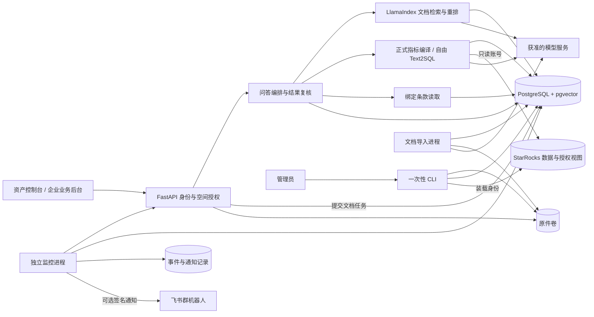

# QueryAtlas｜企业综合问答系统 · 架构方案

2026-11-24 · 设计稿。[需求方案](requirements.md) · [评测方案](evaluation.md)

## 系统边界

采用 Python 模块化单体。FastAPI 提供问答、澄清、追问、引文和资产读取。管理员通过控制台或 CLI 提交文档。两条入口共享权限检查和任务队列，由单写入进程发布文档。跨库数据发布与回滚继续走 CLI。PostgreSQL 保存元数据及授权，pgvector 存储文档向量，StarRocks 执行分析查询。**LlamaIndex 是唯一的 RAG 框架**。业务系统通过 HTTP 提供已验证的用户身份，保留 Java/Spring 等现有调用方的集成方式。

| 模块 | 谁负责什么 | 失败如何处理 |
| --- | --- | --- |
| 空间目录与授权 | 数据负责人审核表、字段、同义词、关联、指标粒度、文档位置及口径版本。管理员独立维护用户、地区、行列、明细与原件权限。 | 先按当前授权选取可用资料和表。权限不明停止该分支，旧业务发布不可恢复旧权限。 |
| 文档接入与 RAG | 解析器产出带定位的内容，LlamaIndex 管理节点转换、Embedding、检索、重排和基于证据的回答。 | 解析失败保留文件及位置。证据不足返回缺项。模型不可用不影响已有资产目录和获准的原文读取。 |
| 指标与自由问数 | 应用维护受审核的计算路径，另提供受限 SQL 生成能力。两条路径共享当前授权视图、会话限制、验证和审计。 | 口径歧义先澄清，拒绝越权与写操作，超时结束。引擎故障仍可返回独立核实的文档回答。 |
| 发布与观测 | PostgreSQL 保存不可变发布清单、当前指针、输入摘要、短期查询上下文与请求编号。StarRocks 保存按批次可定位的数据。 | 候选数据验证完成才切换指针。程序日志记录阶段、耗时、版本和错误类型，凭编号能找到实际查询计划。 |

## 同一套程序怎样接入不同业务

业务空间随配置带入获准的表或视图、字段说明、事实粒度、关系基数、日期和时区、指标公式、可用维度、已审核的文档锚点以及对账样例。专有计算可封装在业务方审核的视图中并随定义版本化。核心路由与提示模板不含客户名、特定表名或行业分支。控制台默认列出空间资产。示例指标、业务报告均在用户选中后才展开。

**第一空间采用官方基准中的 TPC-H。** 基线固定 StarRocks/BenchmarkTool 提交 `0f9ce82ea978318e2830767ad27028659c7434fa`，使用 `bin/gen_data/gen-tpch.sh` 与对应 dbgen 生成数据，参考同版 `sql/tpch` DDL、装载列映射和 `query/tpch` 下的 22 条查询。保存运行时、命令、SF、数据文件哈希、字段顺序、八表导入行数、拒绝行和关键键/金额对账值。在独立候选库使用适配的建表脚本：官方 `ddl_100` 含清理语句，部分表设三副本，单 BE 需改为一副本并记录差异。核对装载列映射可避免把生成文件按目标物理列序误装。[固定版工具与步骤](https://github.com/StarRocks/BenchmarkTool/tree/0f9ce82ea978318e2830767ad27028659c7434fa) · [官方基准环境与规模](https://docs.starrocks.io/docs/benchmarking/TPC-H_Benchmarking/)

| 规模 | 使用场合 | 可报告的结论 |
| --- | --- | --- |
| SF1 | 开发、功能验收和黄金答案复算。先在独立 Linux 环境生成，固定版随附 dbgen 是 Linux x86-64 可执行文件。Apple Silicon 需使用兼容环境或验证从源码构建的生成器。 | 数据与查询是否正确、服务是否可复现。 |
| SF10 | 首选个人调优规模。扩容前测量 SF1 的原始文件、库内数据、候选副本、物化视图及临时空间开销。 | 只报告实装数据量及单节点观察到的性能。 |
| SF100 | 与官方示例同档的可选扩展。官方列举约 6 亿条 lineitem。确认资源后再装载，保留实际 COUNT 和磁盘占用。 | 报告本机或自有集群测量条件及结果。官方耗时单独标注出处，不能填入本项目成绩。 |

迁移验证可在第二个空间挂载 SSB 或 TPC-DS，重新检查资产目录、授权与查询结果。

## CLI 导入和跨库发布

1. **取得单写锁。** CLI 在独立 PostgreSQL 会话持有导入/回滚锁，忙时以非零状态退出。记录空间、源文件、业务定义、解析器、模型和处理版本组成的输入摘要。查询始终读取已发布版本。
2. **暂存。** StarRocks 按批次装载获准数据。CLI 保存不可变原件，解析段落、标题、跨页表格与结构化字段。抽取的规则版本和生效日期附原文位置，由负责人确认后才绑定指标。
3. **校验并切换。** 通过当前授权入口检查候选数据、关系基数、最小对账用例、文档锚点与索引完整性。全部通过后只在原持锁会话中以单个 PostgreSQL 事务登记发布并切换指针。发布清单同时指向数据批次、文档、索引、指标版本。回答固定同一清单。
4. **恢复。** 切换前失败只留下不可见候选。重跑重建未完成部分，已成功的同输入返回同一发布号，重新启用历史版本必须显式回滚。清理暂存要避开仍在线查询及回滚保留的批次。
5. **回滚并检查当前权限。** 收窄地区或撤销文档权限时更新独立授权修订号。只读账号仅能访问现行授权视图，文档定位也按当下权限打开。旧数据无法套用当前规则时拒绝回滚。授权在回答生成期间变化，输出前再次核验，范围变化则丢弃结果。

## 计算与证据

以 TPC-H Q4 为例。查 1993 年第三季度下单且出现延期收货的订单。每笔订单可能有多条明细，直接 JOIN 会重复计数。SQL 用 EXISTS 判断是否存在比承诺日期晚收到的明细，再按优先级对订单计数。

常用问题匹配空间里审核过的 SQL 模板，模板可绑定已发布文档的具体段落。自由问数根据获准的 Schema 生成 SQL，经语法树、表字段和只读检查后执行。结果携带实际 SQL、Query ID 和耗时。模板回答另带指标版本和数据批次。查看历史和打开引用时重新检查当前权限。[SQL 模板](queryatlas/sql_templates.py) · [问答与取证](queryatlas/chat.py)

文档导入时保存原件及页码、段落等定位。LlamaIndex 处理向量化，pgvector 在当前文档授权内计算相似度。关键词融合和重排属于评测计划。

## 实施顺序和采用条件

先确认官方基准的结果正确，再对向量检索、模型生成 SQL 和查询调优分别评测。一致性和耗时按数据集、查询和版本记录。

发布按检索方式、SQL 生成方式和回答方式分别记录版本。增加一个阶段时同步记录它救回哪些题、损失哪些题、每个正确答案的调用成本和 P95。候选未过门槛就继续使用已经验收的路径，证据不足的功能仍提示澄清或仅展示可核对资料。[分阶段对照实验与验收门槛](evaluation.md#三条链路的对照实验)

## 工程验证与交付

- **运行与隔离。** Compose 的常驻服务为 FastAPI、PostgreSQL/pgvector 和单节点 StarRocks。CLI 按需启动并持有独立装载身份。接收上传的 API 与 CLI 可写入以内容摘要命名的原件，下载前重新检查原件权限。批量解析由独立导入进程执行。Spring 调用方用同一 HTTP 接口做联调。
- **实验资源。** 2026-11-23 检查时，已有阿里云业务机系统可见内存约 1.6 GiB，Mac 上的 OrbStack 为 Docker 分配约 8 GB。首轮使用本地 SF1 并记录峰值。官方单机速览要求 Docker 可用内存 4 GB、磁盘 10 GB，这只是示例的配置。大规模和多节点实验使用独立资源。[单机环境说明](https://docs.starrocks.io/docs/quick_start/shared-nothing/)
- **请求预算与可观测性。** 首版交互初值为两条并发分析查询、SQL 限时 10 秒、全请求 30 秒、明细最多 100 行。离线基准使用单独的会话预算并记录超时。按请求编号关联路由、索引版本、检索与重排耗时、模型用量、SQL 指纹、Query ID、业务发布和授权修订号。默认日志不存敏感原文。模型/数据库连续失败、导入失败至少各验证一次告警。
- **验证与回退。** Pytest 覆盖纯业务计算、权限边界及 API。Compose 中运行真实 pgvector、StarRocks 和模型适配的集成验收，测试替身的结果单列。从干净环境完成构建、发布、探针和冒烟。制造一次依赖故障、一次失败导入并演练应用镜像和数据批次分别回退。数据库变更先验证备份、恢复及前后版本兼容。
- **计分依据。** 数据层用官方 22 条查询及手算边界样本做正确性基线，问答层使用盲测集，产品层使用人工配对任务。三个层次分别出报告。现阶段已检查上游工具和设计约束，尚未完成整套服务运行与成绩测量。[验收指标及判分办法](evaluation.md)

## 文档知识库测试部署

控制台、服务账号与 CLI 共用 PostgreSQL 中的空间授权。授权由账号、角色、空间、可选文件名组成。角色列出可执行动作，未授权默认拒绝，检索按授权先过滤候选，下载按当前授权复核。网页和 CLI 均只提交导入任务，worker 负责解析、LlamaIndex IngestionPipeline、本地 BGE Embedding 与 pgvector 原子发布。文件写入内容寻址的原件卷。已落地的是文档级发布，前文跨系统发布仍为目标设计。

独立 watchdog 每十秒探测 API、数据库和导入进程，消费已完成任务。事件、认领人、恢复时间和通知重试队列放在独立 SQLite 卷，PostgreSQL 停机时仍可记录故障。站内按空间显示，平台故障仅管理员可见。受保护的 HTTP 指标供外部监控读取。单机全停需独立主机探针。测试部署和接口见[运行说明](README.md)。

## 已部署的工作台

桌面端使用 React、Ant Design 与 Ant Design X，图表由 ECharts 渲染。对话、授权、数据集发布指针和会话归属存在 PostgreSQL。文档向量使用同库的 pgvector 扩展，StarRocks all-in-one 承担三个 SF1 基准与控制台发布的分析表。模型为测试机本地 Qwen2.5-1.5B-Instruct Q4_K_M，通过 llama.cpp 服务生成回答或候选 SQL。独立 watchdog 监测 PostgreSQL、StarRocks、模型与导入进程。已测边界、原始数据和权限参考见[权限与实机验收](权限与验收.md)。
